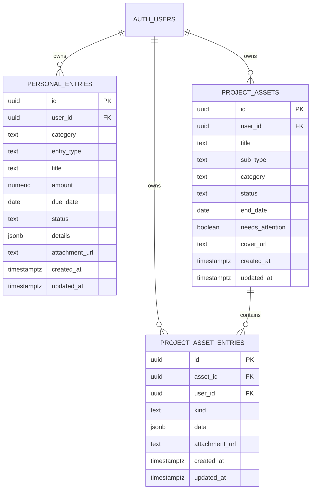
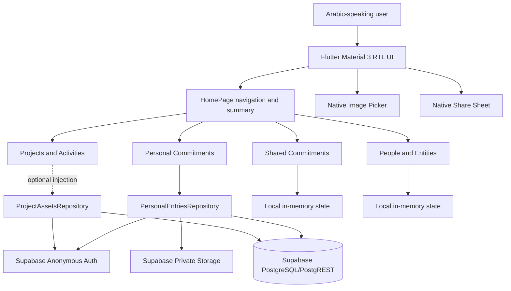
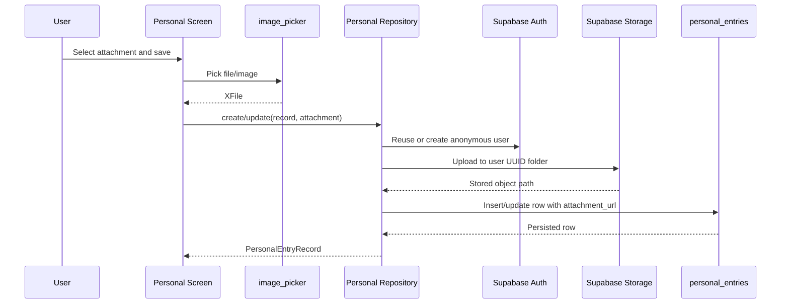

# PROJECT CONTEXT

> Permanent project memory for developers and AI agents.
>
> **Last verified:** 2026-08-17
> **Document status:** Baseline created from the repository, migrations, tests, and verified development history.  
> **Update rule:** After every material feature, schema, architecture, dependency, deployment, security, or workflow change, update the relevant current-state sections and append a dated entry to **Section 21: Development Log**. Never delete historical architectural decisions or old log entries; mark superseded information explicitly.

## 1. Project Overview

### What Fundly Is

Fundly is an Arabic-first, right-to-left Flutter application for managing personal and shared obligations in one place. Its current product surface combines:

- Personal financial and administrative commitments.
- Shared commitments, participants, budgets, and payments.
- People and organization records with related obligations and documents.
- Real estate, projects, business activities, contracts, maintenance, rentals, expenses, revenues, and documents.
- Follow-up dashboards that surface urgent, overdue, incomplete, or upcoming work.

### Business Purpose

The business purpose is to replace fragmented notes, spreadsheets, reminders, document folders, and informal payment tracking with a unified personal and small-business operations dashboard. The app emphasizes quick scanning, Arabic terminology, follow-up status, and context-specific detail forms.

### Main Users

Current UI and domain language target:

- Arabic-speaking individuals managing personal finances and obligations.
- Families or groups managing shared expenses and commitments.
- Freelancers and small-business owners managing contacts, properties, projects, and activities.
- Users who need lightweight document, task, payment, and renewal follow-up.

There is currently no organization/tenant administration model, staff-role model, or conventional account-management UI.

### Long-Term Vision

The directional vision is a reliable Arabic life-and-business management system with persistent, user-isolated data across all modules, consistent dashboards and detail experiences, strong reminders, secure attachment storage, and production-grade multi-platform distribution. Cloud synchronization, richer authentication, reporting, notifications, and broader module persistence are natural next steps, but they are not all implemented or formally committed.

### Current Development Stage

**Stage: functional prototype / early product implementation.**

- The primary Flutter navigation and four management modules are implemented.
- Personal commitments have the most complete Supabase persistence path.
- Supabase schema exists for project assets and sub-entries, but the projects UI still uses local state in important paths and repository injection is optional.
- Shared commitments and people/entities are currently local in-memory experiences.
- Widget regression coverage is substantial for the current UI: 22 tests pass as of 2026-08-06.
- Production release configuration, CI/CD, account recovery, analytics, monitoring, and store deployment are not complete.
- The Git repository currently has no commits on `master`; create a baseline commit before collaborative release work.

---

## 2. Technology Stack

Versions below are from `flutter --version`, `pubspec.yaml`, and `pubspec.lock` on 2026-08-06.

| Technology | Version | Purpose / Why Used |
|---|---:|---|
| Flutter | 3.35.2 stable | Cross-platform UI framework for Android, iOS, web, Linux, and macOS from one codebase. |
| Dart | 3.9.0; constraint `^3.9.0` | Application language, null safety, async data access, and widget logic. |
| Material 3 | Flutter SDK | Main UI system; `useMaterial3: true` with an Arabic RTL-oriented custom visual layer. |
| Cupertino Icons | 1.0.9 locked | iOS-style icons where needed. |
| Supabase Flutter | 2.16.0 locked | Supabase initialization, authentication, PostgREST database access, and Storage access. |
| Supabase Dart | 2.14.0 transitive | Underlying Supabase client implementation. |
| PostgreSQL | Supabase-managed; server version not recorded | Relational persistence, JSONB fields, constraints, indexes, and row-level security. |
| Supabase Auth | Managed service | Anonymous user sessions currently provide per-installation user identities. |
| Supabase Storage | Managed service | Private attachment buckets with user-folder policies. |
| `image_picker` | 1.2.2 locked | Selects images/files from supported device pickers for attachments. |
| `share_plus` | 12.0.2 locked | Opens native share sheets for summaries and commitment details. |
| `flutter_test` | Flutter SDK | Widget and regression testing. |
| `flutter_lints` | 5.0.0 locked | Standard Dart/Flutter analyzer rules. |
| Gradle / Kotlin Android tooling | Flutter-generated configuration | Android compilation and packaging. Exact Gradle/Kotlin versions live in Android build files/wrapper. |
| Xcode project files | Flutter-generated configuration | iOS and macOS builds. Requires macOS/Xcode; not validated on this Windows workstation. |
| Git | Repository initialized, no commits | Intended source control. History is not yet established. |
| Supabase SQL migrations | Repository SQL files | Repeatable database and storage-policy setup. |

### Supported Platform Folders

- Android: present and actively run on a Samsung `SM S928B` during development.
- iOS: generated project present; not validated from Windows.
- Web: generated shell present; production hosting is not configured.
- Linux: generated runner present.
- macOS: generated runner present.
- Windows: no `windows/` platform folder is currently present.

### Not Used

The project does **not** currently use React, TypeScript, Vite, TailwindCSS, Node.js, Express, Netlify, Firebase, GraphQL, a custom backend server, or a state-management package such as Bloc/Riverpod/Provider.

---

## 3. AI Models Used

### Current Integrations

**None.** No AI model, AI SDK, model endpoint, prompt system, embeddings pipeline, or vector database is integrated into the application.

### Planned Models

No specific model/provider has been approved or represented in code. Do not imply that OpenAI, Anthropic, Gemini, Microsoft Foundry, or another provider is part of the architecture unless a future decision is recorded here.

### Development Assistance

AI coding agents may be used to develop the repository, but those tools are not runtime dependencies and are not part of the Fundly product architecture.

---

## 4. APIs

### Supabase Platform APIs

Fundly accesses Supabase through `supabase_flutter`; endpoint construction is handled by the SDK.

| API | Purpose | Authentication | Logical Resources / Endpoints | Rate Limits | Known Issues |
|---|---|---|---|---|---|
| Supabase Auth | Create/reuse an application user session. | Anonymous sign-in; SDK stores session locally. | Project auth endpoint, including anonymous sign-in. Exact request path is SDK-managed. | Supabase project/provider limits; not documented locally. | Anonymous sign-in must be enabled. Uninstall/session loss can create a new identity with no account-recovery path. |
| PostgREST | CRUD for application records. | Supabase publishable/anon key plus user JWT; RLS authorizes rows. | `/rest/v1/personal_entries`, `/rest/v1/project_assets`, `/rest/v1/project_asset_entries` conceptually; SDK-generated. | Supabase project limits; not documented locally. | Projects UI is not fully wired to remote persistence. Shared/people modules have no tables. |
| Supabase Storage | Upload/read private attachments. | User JWT plus Storage RLS policies. | Buckets `personal-entry-attachments` and `project-asset-attachments`; object paths begin with user UUID. | Supabase storage/project limits; not documented locally. | SQL defines insert/select only, not update/delete policies. Replaced/deleted records may leave orphaned objects. |

### Device / Operating-System APIs

| Integration | Purpose | Authentication | Notes |
|---|---|---|---|
| Native share sheet via `share_plus` | Share generated text/details to installed apps. | None. | Platform availability varies. |
| Native image picker via `image_picker` | Select attachment images/files. | OS permissions. | iOS includes a photo-library usage description. Android permissions follow plugin/platform behavior. |

### External APIs Not Present

- No payment API.
- No maps/geocoding API.
- No push-notification API.
- No email/SMS API.
- No analytics or crash-reporting API.
- No custom REST/GraphQL service.
- No AI API.

---

## 5. Environment Variables

The application uses Dart compile-time defines, not a `.env` loader.

| Variable | Purpose | Used In | Required | Current Behavior / Security Note |
|---|---|---|---|---|
| `SUPABASE_URL` | Supabase project base URL. | `lib/config/supabase_config.dart`, initialized in `lib/main.dart`. | Required logically; not required at launch because a fallback is checked in. | Override with `--dart-define`. Move environment-specific values out of source before production. |
| `SUPABASE_ANON_KEY` | Supabase publishable/anon client key. | `lib/config/supabase_config.dart`, initialized in `lib/main.dart`. | Required logically; not required at launch because a fallback is checked in. | This is a public client key, not a server secret, but hard-coded environment coupling is still undesirable. Never use a `service_role` key in Flutter. |

Example:

```powershell
flutter run --dart-define=SUPABASE_URL=https://PROJECT.supabase.co --dart-define=SUPABASE_ANON_KEY=YOUR_PUBLISHABLE_KEY
```

### Generated Local Build Values

`android/local.properties` and generated iOS Flutter files contain machine/build values such as `sdk.dir`, `flutter.sdk`, `flutter.buildMode`, `flutter.versionName`, `flutter.versionCode`, `FLUTTER_ROOT`, `FLUTTER_TARGET`, and build flags. These are generated/local build configuration, not application environment variables, and should not be copied between machines as secrets.

### Missing Environment Management

- No `.env` files.
- No production/staging environment matrix.
- No secret manager integration.
- No CI environment-variable configuration.

---

## 6. Database

### Provider

Supabase-managed PostgreSQL with Supabase Auth, PostgREST, and Storage. Migrations are in `supabase/migrations/`.

### Relationship Diagram



### `public.personal_entries`

Migration: `supabase/migrations/202607190001_create_personal_entries.sql`

| Column | Type / Default | Constraints / Meaning |
|---|---|---|
| `id` | `uuid`, `gen_random_uuid()` | Primary key. |
| `user_id` | `uuid` | Required FK to `auth.users(id)`, cascade delete. |
| `category` | `text` | Required; one of `financial`, `administrative`, `accounts`. |
| `entry_type` | `text` | Required domain-specific type. |
| `title` | `text` | Required display title. |
| `amount` | `numeric(14,2)`, default `0` | Required and non-negative. Dart model currently rounds to `int`. |
| `due_date` | `date` | Optional due date. UI uses `d/M/yyyy`; repository converts to ISO date. |
| `status` | `text`, default `نشطة` | Required Arabic status label. |
| `details` | `jsonb`, default `{}` | Flexible type-specific field map. |
| `attachment_url` | `text` | Object path in private storage, not necessarily a public URL. |
| `created_at` | `timestamptz`, `now()` | Creation order. |
| `updated_at` | `timestamptz`, `now()` | Not automatically updated; no trigger exists. |

Index: `personal_entries_user_created_idx (user_id, created_at DESC)`.

RLS: enabled. Authenticated users may select/insert/update/delete only rows where `auth.uid() = user_id`.

### `public.project_assets`

Migration: `supabase/migrations/202607220001_create_project_assets.sql`

Important fields:

- Identity/ownership: `id`, `user_id`.
- Classification: `title`, `sub_type`, `category` constrained to `real_estate`, `project`, or `business`.
- Status/follow-up: `status`, `followup_note`, `needs_attention`.
- Domain data: `location_or_type`, `amount_label`, `owner`, `tenant`, `rent_value`, `end_date`, `annual_yield`.
- Progress ratios: `occupancy_rate`, `contract_progress`, `payment_progress`, `documents_progress`, each constrained to `[0,1]` where applicable.
- Presentation/media: `icon_color`, `cover_url`.
- Timestamps: `created_at`, `updated_at`; no automatic update trigger.

Index: `project_assets_user_created_idx (user_id, created_at DESC)`.

RLS: enabled with per-user select/insert/update/delete policies.

### `public.project_asset_entries`

Child table for contracts, maintenance, rentals, expenses, revenues, and documents.

| Column | Type / Meaning |
|---|---|
| `id` | UUID primary key. |
| `asset_id` | Required FK to `project_assets(id)`, cascade delete. |
| `user_id` | Required FK to `auth.users(id)`, cascade delete. |
| `kind` | One of `contract`, `maintenance`, `rental`, `expense`, `revenue`, `document`. |
| `data` | JSONB type-specific form payload. |
| `attachment_url` | Optional Storage object path. |
| `created_at`, `updated_at` | Timestamps; no update trigger. |

Index: `project_asset_entries_asset_kind_idx (asset_id, kind, created_at DESC)`.

RLS: enabled with per-user select/insert/update/delete policies. The policy checks `user_id`; it does not separately join and verify the parent asset owner.

### Storage

| Bucket | Public | Path Convention | Policies |
|---|---:|---|---|
| `personal-entry-attachments` | No | `{auth.uid()}/{timestamp}.{ext}` | Authenticated insert/select only when first folder equals user UUID. |
| `project-asset-attachments` | No | Intended user-owned paths | Authenticated insert/select only when first folder equals user UUID. |

### Functions, Triggers, Views

None are defined in current migrations.

Consequences:

- `updated_at` remains its initial value unless the client explicitly writes it; current repositories do not write it.
- No database view or reporting layer exists.
- No scheduled reminder logic exists.

### Tables Not Yet Implemented

There are no database tables for shared commitments, participants, people, organizations, contact documents, reminders, notifications, or app preferences.

---

## 7. Folder Structure

```text
fundly/
├── android/                  # Android Gradle project and native manifest/configuration.
├── assets/
│   ├── images/              # Onboarding/splash image assets.
│   └── README.md            # Asset-specific guidance.
├── build/                   # Generated build outputs; never hand-edit.
├── ios/                     # iOS Xcode project, plist, generated Flutter config.
├── lib/
│   ├── config/
│   │   └── supabase_config.dart
│   ├── data/
│   │   ├── personal_entries_repository.dart
│   │   └── project_assets_repository.dart
│   ├── screens/
│   │   ├── onboarding_screen.dart
│   │   ├── personal_commitments_screen.dart
│   │   ├── shared_commitments_screen.dart
│   │   ├── people_management_screen.dart
│   │   └── projects_activities_screen.dart
│   ├── widgets/
│   │   ├── management_dashboard_chrome.dart
│   │   ├── detail_page_chrome.dart
│   │   ├── followup_center_card.dart
│   │   └── entry_overview_card.dart
│   └── main.dart            # Supabase initialization, app root, home dashboard/navigation.
├── linux/                   # Linux CMake runner.
├── macos/                   # macOS Xcode runner.
├── supabase/
│   └── migrations/          # Authoritative SQL schema and RLS/storage policies.
├── test/
│   └── widget_test.dart     # Current widget/regression suite.
├── web/                     # Flutter web shell, manifest, icons.
├── analysis_options.yaml    # flutter_lints analyzer configuration.
├── pubspec.yaml             # Package metadata, constraints, dependencies, assets.
├── pubspec.lock             # Reproducible resolved dependency versions.
├── SUPABASE_SETUP.md        # Current manual Supabase setup runbook.
├── SETUP_ASSETS.md          # Asset setup instructions.
├── HOW_TO_USE_IMAGES.md     # Image integration notes; partly stale.
├── ASSETS_SETUP_SUMMARY.md  # Historical asset setup summary.
└── PROJECT_CONTEXT.md       # This permanent project memory.
```

### Folder Rules

- Business/data access belongs in `lib/data/`, not directly in reusable widgets.
- Shared visual primitives belong in `lib/widgets/`.
- Feature screens and their feature-local models/forms currently live in `lib/screens/`.
- SQL changes require new chronological migration files; never silently edit an already-applied migration for production changes.
- Generated folders/files (`build/`, `.dart_tool/`, generated platform configs) are not authoritative source.

---

## 8. Architecture

### High-Level Architecture

Fundly is currently a client-heavy Flutter application. There is no custom server. Flutter initializes Supabase directly and uses repository classes for the modules that support cloud persistence.



### Frontend

- `MaterialApp` in `lib/main.dart` is the root.
- Material 3 is enabled.
- Arabic content and `Directionality(TextDirection.rtl)` are applied in management screens.
- Navigation uses `Navigator.push` and material routes, not a routing package.
- State is primarily local `StatefulWidget` state and injected repository instances.
- No global state-management framework or dependency injection container exists.

### Backend

- Supabase is the only backend.
- The app calls Supabase directly from repositories.
- No Edge Functions or custom server are present.

### Authentication

1. A repository checks `SupabaseClient.auth.currentUser`.
2. If absent, it calls `signInAnonymously()`.
3. Supabase stores the resulting session locally.
4. Database rows use the anonymous user's UUID.
5. RLS limits access by `auth.uid()`.

There is no login, signup, email verification, password reset, identity linking, logout UI, or cross-device recovery.

### Database and Storage

- Personal records are cloud-backed through `SupabasePersonalEntriesRepository`.
- Project asset schema and repository exist, but UI integration is incomplete/optional.
- Shared commitments and people/entities remain in memory.
- Attachment paths are stored in table text fields; binary files live in private buckets.

### AI

No AI layer exists.

### Deployment

No automated deployment architecture exists. Builds are currently produced/run with Flutter tooling. See Section 15.

### File Flow: Personal Attachment



### User Flow

1. App launches directly into `HomePage`.
2. User selects one of four domain cards.
3. Each management page shows a pinned dashboard header, search, pinned follow-up center/categories, sorting, and compact cards.
4. User filters/searches, opens a detail page, or starts an add flow.
5. Dynamic bottom sheets collect domain-specific data.
6. Personal records persist to Supabase; other modules may remain local depending on the path.

---

## 9. Features

| Feature | Purpose | Status | Main Files | Dependencies | Known Bugs / Future Work |
|---|---|---|---|---|---|
| Home dashboard | Entry point, category navigation, summary/share workflow. | Implemented | `lib/main.dart` | Flutter, `share_plus` | No persisted preferences; onboarding is bypassed. |
| Arabic RTL UI | Native Arabic terminology and direction. | Implemented | All screens/widgets | Flutter | Validate large text scale and all device widths. |
| Onboarding | Intro pages with image assets and `/home` navigation. | Implemented but not startup-wired | `lib/screens/onboarding_screen.dart`, `assets/images/` | Flutter assets | Documentation still references older custom-painted fallback. |
| Personal commitments dashboard | Search, category filtering, sorting, follow-up metrics, compact list. | Implemented | `personal_commitments_screen.dart`, shared chrome | Flutter | Continue accessibility/device testing. |
| Personal dynamic entry forms | Capture financial, administrative, account, document, task, subscription, and related record types. | Implemented | `personal_commitments_screen.dart` | `image_picker` | Large feature file is difficult to maintain. |
| Personal CRUD persistence | Load/create/update/delete user records. | Implemented | `personal_entries_repository.dart`, personal screen, migration | Supabase Auth/PostgREST | Anonymous identity cannot be recovered; amount DB decimals are rounded into Dart `int`. |
| Personal attachments | Upload private attachments and retain object path. | Implemented for upload/read path | Personal repository, storage migration | Supabase Storage, `image_picker` | No storage delete policy/cleanup; old uploads can be orphaned. |
| Personal details | Compact shared detail template, edit/share/delete/archive flows. | Implemented | personal screen, `detail_page_chrome.dart` | `share_plus` | Keep business behavior covered when refactoring legacy code. |
| Shared commitments | Type filters, sorting, follow-up metrics, creation templates, participants/budget/progress details. | UI implemented, local state | `shared_commitments_screen.dart` | Flutter, `image_picker` in forms | No database persistence or cross-user collaboration. |
| People/entities management | People and organization filters, cards, details, quick-create contact/document flows. | UI implemented, local state | `people_management_screen.dart` | Flutter | No database persistence or relationship model. |
| Projects/assets dashboard | Real estate/projects/activities cards, filters, metrics, add flow. | UI implemented; persistence incomplete | `projects_activities_screen.dart`, project repository | Flutter, Supabase | UI category values can disagree with DB constraint; top-level state remains local. |
| Project sub-entries | Contracts, maintenance, rental, expense, revenue, document forms. | UI implemented; optional repository sync | project screen/repository/migration | Supabase | Delete can remain local; remote errors may be swallowed. |
| Shared dashboard chrome | Reusable pinned header, search, follow-up, category tabs, sorting, compact cards. | Implemented across four pages | `management_dashboard_chrome.dart` | Flutter slivers | Fixed extent must track content/text scale; currently 234 px. |
| Shared detail chrome | Consistent compact details header/tabs/metrics. | Implemented | `detail_page_chrome.dart` and detail screens | Flutter | Extend carefully without erasing module-specific content. |
| Native sharing | Share summaries/details. | Implemented | `main.dart`, personal screen | `share_plus` | Platform-specific behavior requires device checks. |
| Property annex description | Structured counts for corridors, stairs, roof, balconies, utility/civil-defense rooms, plus custom annex text. | Implemented in UI/model/schema | project screen/repository, `202608170001_add_property_description_annexes.sql` | Flutter, Supabase JSONB | Top-level project cloud wiring remains incomplete. |
| Document templates | Fillable debt receipt, handover/receipt, invoice, tax report, contract, and warning templates with save/share. | Implemented locally | `document_templates_screen.dart` | Flutter, SharedPreferences, share_plus | Text sharing is implemented; signed PDF export remains future work. |
| Optional signature | Touch-drawn signature stored only when the user chooses and selectable per template. | Implemented locally | `signature_settings_screen.dart`, `user_signature_store.dart` | Flutter CustomPaint, SharedPreferences | No cloud sync or stamp-image workflow yet. |
| Expiry reminders | User-selected lead times for templates, project contracts/documents, personal documents, and people/entity documents; surfaced in calendar and notification center. | Implemented in-app | `app_reminders_store.dart`, dashboard service, module forms | SharedPreferences | Background OS notification scheduling is not implemented. |
| Widget regression tests | Protect forms, navigation, dashboard geometry, and details templates. | Implemented; 22 passing | `test/widget_test.dart` | `flutter_test` | No repository integration tests, golden tests, or database tests. |

---

## 10. Current Progress

### Completed

- Flutter multi-platform project shell.
- Arabic RTL home and four domain dashboards.
- Consistent management dashboard visual system.
- Pinned dashboard header plus pinned follow-up center/categories on all four management pages.
- Same-row compact sort/list header.
- Shared compact detail-page template across modules.
- Personal commitment repository, Supabase migration, CRUD, anonymous auth, and attachment upload.
- Project asset and child-entry SQL schema plus repository abstraction.
- Dynamic forms for personal, shared, people/entities, and project/activity workflows.
- Assets folder and onboarding image use.
- 22 passing widget tests as of 2026-08-06.

### Partially Completed

- Project assets persistence: repository/schema exist; UI wiring is optional/incomplete.
- Authentication: anonymous sessions exist; real account UX and recovery do not.
- Onboarding: built but not the current app start screen.
- Cross-platform readiness: generated folders exist; Android is the actively tested target.
- Documentation: setup notes exist, but README is generic and some asset documentation is stale.

### Not Started

- Persistent shared commitments and participants.
- Persistent people/organizations and their documents/relationships.
- Notifications/reminders/background scheduling.
- Production authentication and account migration/linking.
- CI/CD and automated deployment.
- Production release signing and store metadata.
- Analytics, crash reporting, and observability.
- AI features.
- Comprehensive unit/integration/golden/database policy tests.

### Current Work

As of 2026-08-06, the current development step is establishing `PROJECT_CONTEXT.md` as permanent project memory after completing and validating the pinned dashboard controls/overflow fix. The next engineering focus should be data-integrity and persistence gaps, beginning with project category/schema alignment and explicit persistence wiring.

---

## 11. Conversation History Summary

Only durable engineering decisions are retained here.

### 2026-08-06: Consolidate Dashboard Visuals

- **Problem:** Personal, shared, people, and project dashboards had inconsistent follow-up centers, categories, and sorting presentation.
- **Solution:** Reused management widgets in `lib/widgets/management_dashboard_chrome.dart` across all four pages.
- **Reason:** One implementation reduces visual drift and makes cross-module maintenance safer.
- **Files modified:** shared dashboard chrome and four management screens.

### 2026-08-06: Standardize Detail Templates

- **Problem:** Detail pages differed structurally and were denser/less consistent than the personal reference page.
- **Solution:** Introduced/reused `DetailPageHeader`, `DetailPageTabs`, metrics, and section tabs while preserving module-specific details.
- **Reason:** Consistency without flattening domain differences.
- **Files modified:** `lib/widgets/detail_page_chrome.dart` and module screens.

### 2026-08-06: Pin Follow-Up and Categories

- **Problem:** Scrolling caused both the follow-up center and categories to disappear.
- **Solution:** Added `ManagementPinnedControls`, a pinned `SliverPersistentHeader`; search scrolls away while follow-up/categories remain fixed and result content scrolls.
- **Reason:** Keeps high-value controls continuously available without pinning the entire page.
- **Files modified:** `management_dashboard_chrome.dart`, four management screens, `test/widget_test.dart`.

### 2026-08-06: Resolve Pinned Controls Overflow

- **Problem:** Physical devices reported `BOTTOM OVERFLOWED BY 8.0 PIXELS` near categories.
- **Solution:** Increased shared fixed extent from 224 to 234 pixels.
- **Reason:** The previous extent did not account for physical Arabic text metrics plus 16 pixels of vertical padding.
- **Files modified:** `management_dashboard_chrome.dart`.

### Durable Form Lifecycle Lesson

- **Problem:** Disposing bottom-sheet `TextEditingController`s too early caused “used after being disposed” errors.
- **Solution:** Dispose controllers in `.whenComplete(...)` after `showModalBottomSheet` closes.
- **Reason:** Bottom-sheet widgets can continue using controllers until route teardown completes.
- **Files involved:** dynamic-form screens, especially people/shared/personal workflows.

---

## 12. Major Decisions

This is a permanent decision log. Add new decisions; never delete old ones. Mark a decision “Superseded by ADR-X” when necessary.

| ID | Date | Decision | Why | Consequences / Status |
|---|---|---|---|---|
| ADR-001 | Before 2026-08-06 | Use Flutter/Dart for the client. | One Arabic UI codebase can target mobile and desktop/web platforms. | Current architecture is client-heavy; native platform validation is still required. |
| ADR-002 | Before 2026-08-06 | Use Supabase rather than a custom server for initial persistence. | Auth, PostgreSQL, RLS, Storage, and generated APIs reduce backend setup. | Client talks directly to Supabase; schema/RLS quality is security-critical. |
| ADR-003 | Before 2026-08-06 | Begin with anonymous authentication. | Allows immediate saving without registration friction. | No cross-device recovery; production account strategy remains unresolved. |
| ADR-004 | Before 2026-08-06 | Use repository interfaces around persisted modules. | Separates UI from Supabase and permits fake repositories in tests. | Personal path benefits today; project UI must finish using the abstraction consistently. |
| ADR-005 | 2026-08-06 | Make personal commitments the visual reference for management/detail experiences. | It is the most mature workflow and establishes consistent density. | Peer pages reuse shared chrome while preserving unique domain content. |
| ADR-006 | 2026-08-06 | Keep follow-up center and categories pinned; let search and result content scroll. | Users retain filtering/follow-up context during long-list navigation. | Uses a fixed 234 px persistent-header extent that needs text-scale testing. |
| ADR-007 | 2026-08-06 | Store flexible type-specific fields in JSONB. | Many domain forms differ and are evolving quickly. | Faster iteration, but weaker schema-level validation/reporting. |
| ADR-008 | 2026-08-06 | Treat `PROJECT_CONTEXT.md` as permanent project memory. | New developers/agents need verified context without chat history. | Every major change requires current-state updates plus an append-only development log entry. |

No decision exists for Netlify, a particular AI model, production hosting, or production authentication. Add an ADR before introducing them.

---

## 13. Pending Tasks

### High Priority

- [ ] Align project/activity UI category values with the database constraint (`real_estate`, `project`, `business`) or add a migration and mapping strategy.
- [ ] Complete project asset and child-entry repository wiring, including remote delete and visible sync-error handling.
- [ ] Decide and implement a recoverable production authentication strategy; plan migration/linking from anonymous users.
- [ ] Remove environment-specific Supabase fallbacks from source for production builds and define dev/staging/prod configuration.
- [ ] Add Storage update/delete policies and attachment cleanup behavior.
- [ ] Add `updated_at` trigger(s) or explicit timestamp updates.
- [ ] Create the first Git baseline commit; repository currently has no history.
- [ ] Configure Android production application ID and release signing.

### Medium Priority

- [ ] Persist shared commitments, participants, payments, and status history.
- [ ] Persist people, organizations, documents, tasks, and relationships.
- [ ] Wire onboarding according to a persisted first-run decision.
- [ ] Replace generic `README.md` with a project-specific developer/product overview.
- [ ] Add repository unit tests, Supabase integration tests, and RLS/storage-policy verification.
- [ ] Add responsive and text-scale tests for fixed pinned controls.
- [ ] Add loading, empty, offline, retry, and explicit sync-status patterns consistently.
- [ ] Add CI for formatting, analysis, tests, and Android build.

### Low Priority

- [ ] Add notification/reminder scheduling.
- [ ] Add reporting/export beyond native text sharing.
- [ ] Validate and brand web, iOS, macOS, and Linux targets.
- [ ] Add analytics/crash reporting after privacy and provider decisions.
- [ ] Split very large screen files into feature-local components/services when behavior is safely covered.
- [ ] Refresh asset documentation to match current `Image.asset` implementation.

### Completed

- [x] Create core Flutter app and home navigation.
- [x] Add Arabic RTL management modules.
- [x] Add personal Supabase schema/repository/CRUD and attachment upload.
- [x] Add project assets/entries schema and repository abstraction.
- [x] Generalize management dashboard visuals.
- [x] Generalize detail-page chrome.
- [x] Pin follow-up center and categories across all management dashboards.
- [x] Resolve categories bottom overflow by increasing pinned extent to 234 px.
- [x] Establish 22 passing widget tests.
- [x] Create this permanent project context baseline.

### Blocked

- Production deployment is blocked by missing release identity/signing, environment strategy, CI/CD, and hosting/store decisions.
- Cross-device data recovery is blocked by the absence of a non-anonymous authentication design.
- iOS/macOS build validation is blocked on this Windows development environment; use macOS with Xcode.

---

## 14. Known Bugs

| Description | Cause | Possible Solution | Priority | Files |
|---|---|---|---|---|
| Project/activity categories can violate DB constraint. | UI may produce values such as `activity`, `equipment`, or `other`, while DB permits only `real_estate`, `project`, `business`. | Define canonical enum/mapping; migrate schema only if new categories are truly required. Add contract tests. | High | `projects_activities_screen.dart`, project repository, project migration |
| Project changes may not persist. | Repository injection is optional and top-level screen uses local sample/state paths. | Inject/use `SupabaseProjectAssetsRepository` at the owning screen and load/save all paths explicitly. | High | project screen/repository |
| Project sub-entry delete may be local only. | UI delete path does not consistently call repository delete. | Await `deleteEntry`, surface errors, update local state only after success or implement rollback. | High | project screen/repository |
| Project remote sync errors can be hidden. | Some sync failures are intentionally swallowed. | Introduce typed result/error state, retry UI, logging, and tests. | High | project screen |
| Anonymous user data is not recoverable across device/session loss. | No account linking/login flow. | Add production auth and anonymous-to-account linking before broad release. | High | repositories, app auth/navigation, Supabase Auth config |
| Attachment objects can become orphaned. | Record update/delete does not remove prior Storage objects; no delete policy. | Add user-scoped delete policy and repository cleanup transaction/compensation logic. | High | migrations, personal/project repositories |
| `updated_at` does not update automatically. | Columns default to `now()` but no trigger/client write exists. | Add a shared trigger function and triggers in a new migration. | Medium | migrations |
| Decimal personal amounts lose cents in client. | DB uses `numeric(14,2)` but Dart model rounds to `int`. | Use integer minor units or a decimal-safe Dart representation consistently. | Medium | personal repository/model/forms |
| Onboarding is bypassed. | `MaterialApp.home` is `HomePage`; onboarding only navigates to `/home`. | Decide first-run behavior and persist completion status. | Medium | `main.dart`, onboarding screen |
| Pinned controls rely on fixed height. | `SliverPersistentHeader` uses 234 px to fit current content. | Test text scale/locales; consider a controlled adaptive extent if requirements expand. | Medium | management dashboard chrome, widget tests |
| Asset docs are stale. | Historical docs describe custom-painted fallback while current screen uses image assets. | Update or archive obsolete instructions. | Low | asset docs, onboarding screen |
| No Git history exists. | Repository initialized but no commits made. | Review generated/secret files, then create baseline commit. | High operational | repository root |

Previously reported and fixed: category-area `BOTTOM OVERFLOWED BY 8.0 PIXELS`; fixed on 2026-08-06 by setting the shared pinned extent to 234 px.

---

## 15. Deployment

### Current State

There is no configured production deployment, Netlify setup, CI/CD workflow, production URL, preview URL, or rollback pipeline.

### Local Run

```powershell
flutter pub get
flutter run --dart-define=SUPABASE_URL=https://PROJECT.supabase.co --dart-define=SUPABASE_ANON_KEY=YOUR_PUBLISHABLE_KEY
```

The checked-in fallback currently allows running against the existing development Supabase project, but explicit defines are preferred.

### Validation Commands

```powershell
flutter analyze
flutter test
flutter build apk --debug
```

Last verified widget suite: 22 passing tests on 2026-08-06.

### Build Commands

```powershell
# Android
flutter build apk --release
flutter build appbundle --release

# Web
flutter build web

# iOS/macOS require macOS + Xcode
flutter build ios
flutter build macos

# Linux requires a configured Linux host
flutter build linux
```

### Publish Folders / Artifacts

- Web: `build/web/` after `flutter build web`.
- Android APKs: under `build/app/outputs/flutter-apk/`.
- Android app bundle: under `build/app/outputs/bundle/release/`.
- Other platform artifacts follow Flutter defaults.

### Netlify

Not configured. If web hosting is later approved, document build command, publish folder (`build/web`), SPA rewrite rules, environment injection strategy, production URL, preview URL, and rollback process here. Do not describe Netlify as current architecture.

### Production Gaps

- Android package remains `com.example.fundly`.
- Release signing currently uses non-production/default setup.
- Apple identifiers and signing are not production-ready/verified.
- Web title/manifest contain generic Flutter defaults.
- No staging/production Supabase separation.
- No deployment approval or rollback procedure.

### Rollback

No automated rollback exists. Once Git and CI/CD are established, rollback should rebuild/redeploy a known tested tag. Database migrations require forward-fix migrations; do not destructively rewrite applied migration history.

---

## 16. Security

### Authentication

- Current method: Supabase anonymous authentication.
- Repositories reuse the current user or call `signInAnonymously()`.
- Anonymous sign-in must be enabled in the Supabase dashboard.

### Authorization

- RLS is enabled on all current application tables.
- CRUD policies scope rows to `auth.uid() = user_id`.
- Storage policies scope object insert/select to a top-level folder equal to the user UUID.

### Secrets and API Keys

- Never place a Supabase `service_role` key in Flutter, Git, logs, tests, or this document.
- The publishable/anon key is designed for clients and depends on RLS, but environment-specific fallback values should still be removed from source before production.
- Do not print session tokens or user data in diagnostics.

### Permissions

- iOS includes a photo-library usage description.
- Review Android/iOS permissions whenever picker behavior changes.
- Native sharing sends user-selected/generated content to third-party apps; clearly scope what is shared.

### Storage Rules

Positive controls:

- Buckets are private.
- Paths are user-prefixed.
- Read/upload are user-scoped.

Gaps:

- No update/delete object policies.
- No attachment size/type restrictions documented at database policy level.
- No malware/content scanning.
- No orphan cleanup.

### Security Considerations

- Anonymous identity is a security/usability tradeoff, not a permanent account model.
- JSONB allows flexible payloads; validate required fields and acceptable values in the client and preferably server-side constraints/functions where critical.
- Add explicit parent-ownership validation for child records if schema usage expands.
- Review RLS with automated tests before production.
- Ensure logs and analytics, when added, avoid sensitive financial/document content.

---

## 17. Performance

### Existing Optimizations / Stability Controls

- Database indexes support per-user newest-first lists and per-asset/kind newest-first child entries.
- Repository network operations use a 15-second timeout.
- Sliver-based dashboards lazily build scrolling result content.
- Follow-up/category controls are shared and pinned for interaction efficiency.
- Async UI paths commonly use `mounted` checks before state updates.
- Compact cards reduce vertical density for repeated scanning.

### Caching

- Supabase Auth persists its session through the SDK.
- No explicit application data cache, offline database, query cache, or cache invalidation layer exists.
- Local in-memory lists serve as temporary state for several modules but are not durable caching.

### Lazy Loading

- `CustomScrollView`, `SliverList`, and horizontal lists are used for dashboards.
- Some large child lists may still be materialized into `SliverChildListDelegate` arrays; monitor as real data volumes grow.

### Database Optimization

Current indexes are appropriate for known list queries. Missing future considerations:

- Pagination rather than unbounded `select()` calls.
- Additional indexes for status, due date, category, and full-text search when server-side filtering is introduced.
- Query plans and realistic volume tests.

### Network Optimization

- Current fetches select full rows and have no pagination.
- Search/filtering is mostly client-side.
- Attachments are uploaded as whole byte arrays; no compression/resizing/resumable upload strategy is documented.

### Known Bottlenecks

- Very large screen files increase build/maintenance cost.
- Full-table per-user fetches will degrade with growth.
- Client-side metrics scan lists repeatedly.
- Fixed pinned controls consume a significant portion of short screens.
- In-memory modules lose data rather than facing network cost; persistence implementation will need pagination/sync design.

---

## 18. Coding Standards

### Dart / Flutter

- Follow `flutter_lints` and keep `flutter analyze` free of new errors.
- Use null safety and explicit domain names; avoid one-letter identifiers.
- Prefer `const` widgets/values where practical.
- Preserve Arabic RTL semantics and existing terminology.
- Use Material 3 and existing shared chrome rather than duplicating dashboard/detail styles.
- Keep comments brief and only where behavior is not self-explanatory.

### Naming

- Files: `snake_case.dart`.
- Public classes/widgets: `UpperCamelCase`.
- Private implementation symbols: leading underscore.
- Variables/methods: `lowerCamelCase`.
- Database tables/columns: `snake_case`.
- Stable UI test keys: descriptive `ValueKey` strings.

### Architecture and Folder Rules

- Repository interfaces define persistence contracts.
- Supabase-specific implementations remain in `lib/data/`.
- Reusable visual components go in `lib/widgets/`.
- Feature-specific forms/models may remain in their screen during rapid iteration, but extract them when complexity/duplication justifies it and tests protect behavior.
- Use structured JSON/SQL APIs, not ad hoc serialized strings.

### Widget Rules

- Preserve `ManagementDashboardHeader`, `ManagementPinnedControls`, `ManagementFollowUpCenter`, `ManagementCategoryTab`, `ManagementSortHeader`, and `ManagementCompactCard` consistency.
- Preserve shared detail chrome while retaining module-specific details.
- For bottom-sheet controllers, dispose them only after the sheet route completes (`.whenComplete`).
- Validate fixed-height components at target mobile dimensions and with Arabic text.

### Formatting and Testing

```powershell
dart format lib test
flutter analyze
flutter test
```

Use the IDE/Dart formatter for touched files. Historically, formatting `test/widget_test.dart` once malformed a project-screen import; inspect imports after broad formatting.

### Commit Messages

No repository convention exists yet. Recommended baseline:

```text
feat(scope): concise behavior change
fix(scope): concise bug fix
test(scope): coverage change
docs(scope): documentation change
refactor(scope): behavior-preserving restructuring
chore(scope): tooling/configuration
```

Each commit should be focused, tested, and avoid generated build output or secrets.

---

## 19. Important Files

| File | Why It Exists | Relationships |
|---|---|---|
| `lib/main.dart` | Initializes Supabase, defines app/theme/home, and owns top-level navigation/summary behavior. | Imports all four management screens and Supabase config. |
| `lib/config/supabase_config.dart` | Defines compile-time Supabase URL/key settings. | Consumed by `main.dart`; production security/configuration hotspot. |
| `lib/data/personal_entries_repository.dart` | Personal record model, repository contract, Supabase CRUD/auth/storage implementation. | Used by personal screen and fake implementation in tests; maps to `personal_entries`. |
| `lib/data/project_assets_repository.dart` | Project asset/entry models and Supabase contracts/implementation. | Maps to project tables; UI wiring remains incomplete. |
| `lib/screens/personal_commitments_screen.dart` | Most mature/reference management module and details flow. | Uses personal repository, shared dashboard/detail widgets, picker/share packages. |
| `lib/screens/shared_commitments_screen.dart` | Shared commitment templates, participants, budgets, and local management state. | Uses shared dashboard/detail chrome; future schema needed. |
| `lib/screens/people_management_screen.dart` | People/entities dashboards, details, and dynamic creation forms. | Uses shared chrome; future repository/schema needed. |
| `lib/screens/projects_activities_screen.dart` | Projects/assets dashboard and typed sub-entry flows. | Should integrate project repository consistently; maps to project migrations. |
| `lib/screens/onboarding_screen.dart` | Intro/page-view flow. | Uses assets and `/home`; currently not startup route. |
| `lib/widgets/management_dashboard_chrome.dart` | Cross-module dashboard design and pinned controls behavior. | Used by all four management screens; fixed extent currently 234 px. |
| `lib/widgets/detail_page_chrome.dart` | Cross-module compact detail-page structure. | Used by domain detail screens. |
| `supabase/migrations/202607190001_create_personal_entries.sql` | Personal table, index, RLS, bucket, storage policies. | Must match personal repository model. |
| `supabase/migrations/202607220001_create_project_assets.sql` | Project tables, indexes, RLS, bucket, storage policies. | Must match project repository and UI category/kind values. |
| `test/widget_test.dart` | Current regression safety net (22 tests). | Covers home, forms, dashboards, pinned geometry, details, edit/delete/archive flows. |
| `pubspec.yaml` / `pubspec.lock` | SDK constraints, direct dependencies, assets, resolved versions. | Required for reproducible setup. |
| `SUPABASE_SETUP.md` | Manual backend setup. | Currently focuses mainly on personal entries; expand for all migrations. |
| `PROJECT_CONTEXT.md` | Permanent verified project memory. | Must be updated after every major change. |

---

## 20. AI Agent Instructions

Any AI agent working on Fundly must follow these instructions:

1. Read `PROJECT_CONTEXT.md` before searching or editing.
2. Verify the current code because this document can lag; if code and context differ, treat code/migrations/tests as evidence and update this document.
3. Start from the smallest owning file, symbol, failing behavior, or test.
4. Never rewrite working code merely for style. Preserve business behavior and Arabic terminology.
5. Understand data ownership, navigation, repository boundaries, RLS, and storage policies before architectural changes.
6. Prefer existing shared dashboard and detail components over new duplicate UI.
7. Preserve backward compatibility unless an approved migration/decision explicitly breaks it.
8. Ask before deleting features, tables, migrations, user data, or historical decisions.
9. Never place service-role keys, session tokens, or private secrets in client code or documentation.
10. Add new SQL changes as new chronological migrations; do not rewrite migration history already applied remotely.
11. Test the narrow changed behavior immediately after the first substantive edit, then run broader validation.
12. For Flutter UI changes, check overflow, RTL, keyboard/insets, scrolling, and target phone dimensions.
13. For bottom-sheet dynamic forms, dispose controllers after the sheet closes.
14. Do not silently swallow persistence errors; preserve or improve user-visible failure handling.
15. Update this file after every major feature, schema, API, dependency, security, deployment, or architectural change.
16. Append to Section 21 chronologically. Never delete prior log entries; mark corrections/supersession.
17. Add/modify ADR entries in Section 12 for durable architecture decisions and explain problem, choice, alternatives, and consequences.
18. Keep Sections 10, 13, 14, 15, and 24 synchronized with current reality.
19. Run `flutter analyze` and relevant tests. Report any validations that cannot run.
20. Do not claim an integration, deployment, URL, AI model, or production status without repository/tool evidence.

### Required Context Update Checklist

After a major change, update as applicable:

- `Last verified` date.
- Stack/dependency versions.
- APIs/environment variables.
- Database schema/policies/storage.
- Architecture and diagrams.
- Feature status.
- Current progress and current task.
- Major decisions.
- Pending/completed tasks.
- Known bugs.
- Deployment/security/performance notes.
- Development log.
- Quick Start for New AI Agent.

---

## 21. Development Log

Chronological, append-only log. When the exact historical date is unknown, say so rather than inventing one.

### Before 2026-08-06 (Exact Dates Not Recorded)

- **Summary:** Created Flutter app shell, Arabic home dashboard, onboarding, and four management modules.
- **Files changed:** `lib/main.dart`, `lib/screens/*`, assets/platform scaffolding.
- **Reason:** Establish product navigation and core domain experiences.
- **Impact:** Functional client prototype with substantial local-state workflows.

### 2026-07-19 (Migration Filename Date)

- **Summary:** Added personal entries table, index, RLS, and private attachment bucket/policies.
- **Files changed:** `supabase/migrations/202607190001_create_personal_entries.sql`, personal repository/setup docs.
- **Reason:** Persist personal records securely per anonymous user.
- **Impact:** Personal commitments can survive app restarts when Supabase is configured.

### 2026-07-22 (Migration Filename Date)

- **Summary:** Added project assets and child entries schema, indexes, RLS, attachment bucket, and repository abstraction.
- **Files changed:** `supabase/migrations/202607220001_create_project_assets.sql`, `lib/data/project_assets_repository.dart`.
- **Reason:** Prepare persistence for projects, real estate, business activities, and typed sub-entries.
- **Impact:** Backend contract exists; complete UI wiring remains pending.

### 2026-08-06

- **Summary:** Unified follow-up center visual design and same-row sorting across management dashboards.
- **Files changed:** shared management chrome and four management screens.
- **Reason:** Remove cross-module inconsistency.
- **Impact:** Shared visual ownership and denser consistent scanning.

### 2026-08-06

- **Summary:** Generalized the personal detail-page template across shared commitments, people, and projects/activities while preserving distinct content.
- **Files changed:** `lib/widgets/detail_page_chrome.dart`, module screens, tests.
- **Reason:** Consistent detail navigation and information hierarchy.
- **Impact:** Reusable detail chrome with regression coverage.

### 2026-08-06

- **Summary:** Added pinned follow-up/categories controls across all four dashboards; search scrolls away and result lists continue scrolling.
- **Files changed:** `lib/widgets/management_dashboard_chrome.dart`, four management screens, `test/widget_test.dart`.
- **Reason:** Keep follow-up and category context available during long-list scrolling.
- **Impact:** Added shared `SliverPersistentHeader` behavior and geometry regression test.

### 2026-08-06

- **Summary:** Fixed `BOTTOM OVERFLOWED BY 8.0 PIXELS` in pinned categories by increasing shared extent from 224 to 234 px.
- **Files changed:** `lib/widgets/management_dashboard_chrome.dart`.
- **Reason:** Physical Arabic text metrics exceeded the previous available content height.
- **Impact:** All four pages fixed through one shared change; 22 tests passed and touched files had no errors.

### 2026-08-06


### 2026-08-06

- **Summary:** Reworked home bottom navigation to four functional tabs (`الرئيسية`, `التقارير`, `الأرشيف`, `المحافظ`) and added dedicated pages for reports, archive, and wallets.
- **Files changed:** `lib/main.dart`.
- **Reason:** Make bottom navigation semantically aligned with product domains instead of placeholder tabs.
- **Impact:** Users can now switch to logical in-app sections from the bottom bar, with structured reporting/archive/wallet experiences.

### 2026-08-06

- **Summary:** Updated home header greeting to `مرحباً عبدالعزيز` and made it interactive to open a dedicated account page with global-style account settings sections.
- **Files changed:** `lib/main.dart`.
- **Reason:** Improve personalization and provide a clear account entry point from the main header.
- **Impact:** Header identity is now actionable; account-related settings are grouped in a standalone screen.

### 2026-08-06

- **Summary:** Refined home category metric chips into a cleaner icon + colored text line style (removed colored metric boxes) across the four top-level modules.
- **Files changed:** `lib/main.dart`.
- **Reason:** Improve readability and visual consistency with less noise in the home cards while preserving the same information and icons.
- **Impact:** Home cards now show lighter, professional metric lines with unified readable typography; behavior/navigation unchanged.

### 2026-08-17

- **Summary:** Implemented structured property annex descriptions, six reusable document/receipt templates, an optional touch-drawn signature, and configurable expiry reminders surfaced in the Smart Calendar and notification center.
- **Files changed:** project/personal/people/profile/report screens, dashboard/notification services, new reminder/signature/template files, project repository, migration `202608170001_add_property_description_annexes.sql`, and focused tests.
- **Reason:** Apply the supplied product guidance to the correct domain workflows rather than adding isolated display text.
- **Impact:** Users can capture annex counts, create/save/share common Arabic document models, opt into a stored signature, and choose reminder lead times for expiring document-like records. OS-level background notification delivery and signed PDF generation remain separate future enhancements.

### 2026-08-17

- **Summary:** Fixed the Home PIN picker tab overflow and moved Delegations from the bottom navigation into Settings.
- **Files changed:** `lib/main.dart`, `lib/screens/profile_settings_screen.dart`, and focused widget tests.
- **Reason:** Icon-and-text PIN tabs needed more vertical space, while Delegations belongs with account and permission management rather than primary navigation.
- **Impact:** The PIN picker no longer reports a 4-pixel overflow; bottom navigation now contains Home, Reports/Archive, Wallets, and More, and the existing Delegations workflow opens from Settings.

### 2026-08-17

- **Summary:** Rebuilt Delegations around explicit access scope, permissions, duration, and lifecycle statuses, with a coordinated hub, form, cards, filters, and details page.
- **Files changed:** `lib/main.dart`, `test/delegations_screen_test.dart`.
- **Reason:** The former layout used oversized typography and ambiguous status logic that treated paused records as expired and reset edited records to active.
- **Impact:** Delegations now distinguish active, expiring, paused, scheduled, and expired states; filtered actions target the correct source record; editing preserves activation state; and creation validates the delegate, permissions, and date order.

---

## 22. Future Roadmap

Roadmap items are directional and require prioritization/product approval.

### Near Term: Reliability and Persistence

- Canonicalize domain enums between UI, repositories, and SQL.
- Complete project/assets cloud synchronization.
- Add recoverable authentication and anonymous account linking.
- Add storage cleanup and timestamp triggers.
- Persist shared commitments and people/entities.
- Add explicit loading/retry/offline states.
- Establish Git history and CI quality gates.

### Medium Term: Product Completeness

- Background OS notification scheduling for the existing in-app expiry reminders.
- Payment schedules and status history.
- Relationship graph between people, commitments, properties, and documents.
- Search/filter pagination and server-side queries.
- Export/report generation.
- Account settings, data export, and deletion.
- Production Android/iOS distribution.

### Scalability Ideas

- Introduce feature folders and smaller widgets/controllers as modules stabilize.
- Add pagination and incremental loading.
- Add a sync/offline layer only after conflict semantics are designed.
- Replace unstructured JSONB fields with normalized columns/tables where reporting and validation demand it.
- Add audit/history tables for critical financial changes.
- Add background jobs/Edge Functions only when server-side reminders or integrations require them.

### Possible Integrations

Not approved/current; evaluate through ADRs:

- Calendar integration.
- Push notifications.
- OCR/document extraction.
- Maps/geocoding.
- Banking/payment providers.
- AI-assisted categorization or follow-up summaries.

Any AI integration must define provider, model, privacy/data retention, consent, cost/rate limits, failure behavior, and whether sensitive financial/document data leaves Supabase.

### Long-Term Goals

- Trusted Arabic-first personal and small-business management platform.
- Secure cross-device continuity.
- Complete domain persistence and collaboration.
- Clear operational insights without losing simple daily usability.
- Production-grade observability, testing, privacy, and recovery.

---

## 23. Recovery Instructions

Use this section to restore the project after cloning.

### Prerequisites

1. Git.
2. Flutter 3.35.2 stable or a compatible Flutter `>=3.35.0` with Dart `>=3.9.0 <4.0.0`.
3. VS Code/Android Studio with Flutter and Dart extensions.
4. Android Studio/SDK and an emulator/device for Android.
5. For iOS/macOS: macOS, Xcode, CocoaPods as required by Flutter.
6. A Supabase project with access to Auth, SQL Editor/migrations, and Storage.

### Clone and Install

```powershell
git clone <REPOSITORY_URL>
Set-Location fundly
flutter doctor
flutter pub get
```

The repository currently has no commits/remote URL recorded; establish those before this process can work for another machine.

### Configure Supabase

1. Create/select a Supabase project.
2. Enable **Authentication > Providers > Anonymous Sign-Ins**.
3. Apply migrations in filename order:
   - `supabase/migrations/202607190001_create_personal_entries.sql`
   - `supabase/migrations/202607220001_create_project_assets.sql`
4. Verify tables, RLS policies, private buckets, and storage policies.
5. Obtain the project URL and publishable/anon key. Never use `service_role` in the app.

If Supabase CLI is introduced later, document its version/linking and migration command here. Current setup is manual through SQL Editor.

### Run

```powershell
flutter run --dart-define=SUPABASE_URL=https://PROJECT.supabase.co --dart-define=SUPABASE_ANON_KEY=YOUR_PUBLISHABLE_KEY
```

### Test and Analyze

```powershell
flutter analyze
flutter test
```

Expected baseline on 2026-08-06: 22 widget tests passing. The project may contain pre-existing analyzer warnings; do not add new errors and document cleanup separately.

### Build

```powershell
flutter build apk --debug
flutter build apk --release
flutter build appbundle --release
flutter build web
```

Release builds require proper identifiers/signing before distribution.

### Database Verification

1. Launch Personal Commitments.
2. Add an entry.
3. Restart the app.
4. Confirm the entry reloads.
5. Check `personal_entries` and verify `user_id` matches the anonymous auth user.
6. Upload an attachment and verify the object path starts with that user UUID.
7. Test that a different user cannot read the row/object.

### Troubleshooting

| Symptom | Check |
|---|---|
| Supabase initialization failure | Confirm URL/key defines, network access, and project status. |
| Save creates auth error | Enable anonymous sign-ins. |
| Table/schema error | Apply both migrations in order to the correct project. |
| RLS denial | Confirm a valid user session and matching `user_id`; never bypass with service-role in the client. |
| Attachment upload denied | Confirm bucket/policies and UUID-first object path. |
| Android device missing | Run `flutter devices`, enable USB debugging, verify Android SDK/ADB. |
| UI overflow | Reproduce at target size/text scale; inspect shared fixed extents before per-screen patches. |
| Bottom-sheet controller error | Dispose controllers in `.whenComplete` after sheet closure. |
| iOS cannot build on Windows | Move build to macOS/Xcode. |
| Stale generated output | Run `flutter clean`, then `flutter pub get`; do not hand-edit `build/`. |

### Recovery Safety

- Do not delete Supabase tables/buckets to “reset” without explicit data-loss approval.
- Back up production data before migrations.
- Use forward migrations for schema fixes.
- Preserve `PROJECT_CONTEXT.md` history and update it after recovery discoveries.

---

## 24. Quick Start for New AI Agent

### One-Minute Onboarding

**Project:** Arabic-first Flutter 3.35.2 application for personal/shared commitments, people/entities, and projects/assets. Supabase is the only backend.

**Current status:** Core UI is functional. Personal commitments persist to Supabase. Project persistence is only partially wired. Shared commitments and people/entities are local state. Four dashboards share pinned follow-up/categories and compact detail chrome. The widget suite has 22 passing tests as of 2026-08-06.

**Current task:** This context baseline has just been created after fixing the pinned categories overflow. The next high-value work is to align project category values with SQL and finish project repository wiring with explicit error/delete handling.

**Open first:** 

1. `PROJECT_CONTEXT.md`
2. `lib/main.dart`
3. `lib/widgets/management_dashboard_chrome.dart`
4. The requested feature screen in `lib/screens/`
5. Its repository in `lib/data/`
6. Relevant SQL in `supabase/migrations/`
7. `test/widget_test.dart`

**Important warnings:**

- Do not put a Supabase service-role key in Flutter.
- Do not assume all modules persist data.
- Do not rewrite large working screens without focused tests.
- Preserve Arabic RTL behavior and shared dashboard/detail patterns.
- Pinned controls currently require a 234 px extent; test overflow if content changes.
- Dispose bottom-sheet controllers only after the sheet closes.
- UI project categories currently risk violating DB constraints.
- There is no Git commit history yet.
- Update this document and append Section 21 after every major change.
